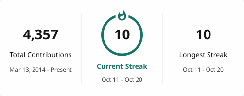

# GitHub Activity

<!-- markdownlint-disable MD013 -->
<picture>
  <source
    media="(prefers-color-scheme: dark)"
    srcset="./profile/rolling-dark.svg"
  />
  
</picture>
<!-- markdownlint-enable MD013 -->

<!-- markdownlint-disable MD013 -->
<picture>
  <source
    media="(prefers-color-scheme: dark)"
    srcset="./profile/stats-dark.svg"
  />
  
</picture>
<!-- markdownlint-enable MD013 -->

<!-- markdownlint-disable MD013 -->
<picture>
  <source
    media="(prefers-color-scheme: dark)"
    srcset="./profile/streak-dark.svg"
  />
  
</picture>
<!-- markdownlint-enable MD013 -->

<!-- markdownlint-disable MD013 -->
<picture>
  <source
    media="(prefers-color-scheme: dark)"
    srcset="./profile/languages-dark.svg"
  />
  
</picture>
<!-- markdownlint-enable MD013 -->
