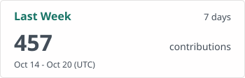
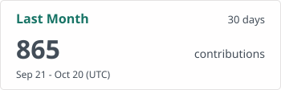

# GitHub Activity

<!-- markdownlint-disable MD013 MD033 -->

  <picture>
    <source
      media="(prefers-color-scheme: dark)"
      srcset="./profile/week-dark.svg"
    />
    
  </picture>
  <picture>
    <source
      media="(prefers-color-scheme: dark)"
      srcset="./profile/month-dark.svg"
    />
    
  </picture>

  <picture>
    <source
      media="(prefers-color-scheme: dark)"
      srcset="./profile/rolling-dark.svg"
    />
    
  </picture>
  <picture>
    <source
      media="(prefers-color-scheme: dark)"
      srcset="./profile/stats-dark.svg"
    />
    
  </picture>

  <picture>
    <source
      media="(prefers-color-scheme: dark)"
      srcset="./profile/streak-dark.svg"
    />
    
  </picture>
  <picture>
    <source
      media="(prefers-color-scheme: dark)"
      srcset="./profile/languages-dark.svg"
    />
    
  </picture>

<!-- markdownlint-enable MD013 MD033 -->
